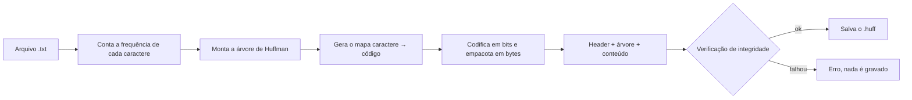
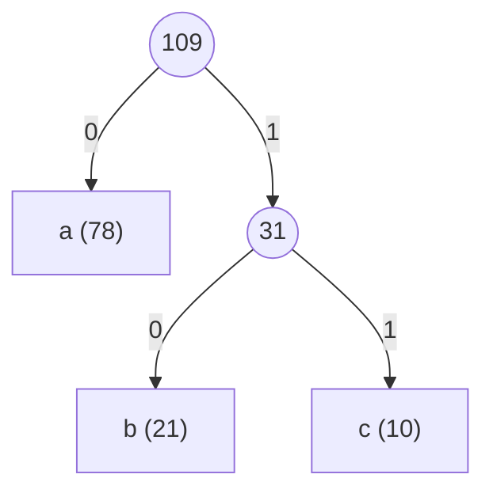

# Compressão de arquivos de texto com Huffman Coding em Rust

Um motor de compressão de arquivos construído do zero em Rust, implementando o algoritmo de **Huffman Coding**. O projeto nasceu como estudo: a ideia era entender como um compressor funciona por dentro, desde a contagem de caracteres até a escrita dos bits no disco.

Nenhuma biblioteca de compressão foi usada. A única dependência externa é o [`clap`](https://crates.io/crates/clap), que cuida apenas das flags do terminal e não tem relação com o algoritmo em si.

## Funcionalidades

- Compressão de arquivos de texto para o formato `.huff`
- Descompressão de volta para `.txt`
- Nome do arquivo de saída gerado automaticamente a partir do arquivo de entrada
- Pasta de saída padrão em `./output`, configurável com `-o`
- **Verificação de integridade** automática: depois de comprimir, o programa descomprime o resultado em memória e compara byte a byte com o original. Se algo divergir, nenhum arquivo é gravado
- Tabela comparativa de tamanhos (original vs. comprimido) com a taxa de redução

## Como usar

Basta ter o [Rust](https://www.rust-lang.org/tools/install) instalado.

```bash
cargo run -- --compress ./input/hello.txt            # gera ./output/hello.huff
cargo run -- --decompress ./output/hello.huff        # gera ./output/hello.txt
cargo run -- --compress ./input/hello.txt -o ./saida # pasta de saída customizada
```

| Flag | Descrição |
| --- | --- |
| `--compress <ARQUIVO>` | Comprime um arquivo de texto e gera um `.huff` |
| `--decompress <ARQUIVO.huff>` | Restaura o texto original a partir de um `.huff` |
| `-o`, `--output <PASTA>` | Pasta de saída (padrão: `./output`) |
| `--help` | Mostra a ajuda gerada pelo `clap` |

As flags `--compress` e `--decompress` são mutuamente exclusivas, e uma das duas é obrigatória.

Ao final, o programa mostra o resultado:

```
┌─────────────────┬────────────────┐
│ Original        │        15535 B │
│ Comprimido      │        11279 B │
│ Taxa de redução │         27.40% │
└─────────────────┴────────────────┘
```

O tamanho "Comprimido" é o do arquivo `.huff` inteiro (header + árvore + conteúdo), ou seja, o tamanho real em disco. Como não há nenhuma otimização, o ganho depende bastante do conteúdo: textos grandes, com poucos caracteres distintos e distribuição bem desigual comprimem mais.

## Como funciona

A ideia central: em vez de gastar 8 bits para cada caractere, gastamos **poucos bits para os caracteres frequentes** e **mais bits para os raros**.



### 1. Contagem de frequência

Percorremos o arquivo inteiro contando quantas vezes cada caractere aparece. Por exemplo: `a: 78`, `b: 21`, `c: 10`.

### 2. Montagem da árvore binária

Pegamos sempre os **dois itens de menor frequência**, juntamos num novo nó cujo peso é a soma dos dois, e repetimos até sobrar um único nó (a raiz). Os caracteres ficam nas folhas.



### 3. Código de cada caractere

O código de um caractere é o caminho da raiz até a folha dele: ir para a esquerda adiciona um `0`, ir para a direita adiciona um `1` (essa convenção é arbitrária, o importante é usar a mesma na compressão e na descompressão).

| Caractere | Frequência | Código | Bits |
| --- | --- | --- | --- |
| `a` | 78 | `0` | 1 |
| `b` | 21 | `10` | 2 |
| `c` | 10 | `11` | 2 |

Como nenhum código é prefixo de outro, não existe ambiguidade na leitura. Nesse exemplo, 109 caracteres ocupariam 872 bits (109 × 8) e passam a ocupar 140 bits (78×1 + 21×2 + 10×2).

Em geral, caracteres muito frequentes ganham códigos curtos e caracteres raros ganham códigos longos, que em arquivos com muitos símbolos diferentes podem até passar de 8 bits.

### 4. Escrita dos bits

Os códigos são concatenados num fluxo de bits (`0100101000111010...`) e empacotados em bytes, **do bit mais significativo para o menos significativo**. O último byte é completado com zeros (padding), e o header guarda quantos bits são realmente válidos, para o padding nunca ser lido como dado.

### 5. Descompressão

O arquivo `.huff` carrega a própria árvore. Para descomprimir, reconstruímos a árvore e caminhamos por ela bit a bit: `0` desce para a esquerda, `1` para a direita, e ao chegar numa folha emitimos o caractere e voltamos para a raiz.

> Isso é codificação, não criptografia: quem tem o arquivo `.huff` consegue decodificá-lo, pois a árvore vai junto.

## Formato do arquivo `.huff`

Todos os números são gravados em **big-endian**.

| Offset | Tamanho | Campo |
| --- | --- | --- |
| 0 | 4 B | Magic bytes `HUFF` (`72 85 70 70`) |
| 4 | 8 B | Tamanho do arquivo original (`u64`) |
| 12 | 4 B | Tamanho da árvore serializada em bytes (`u32`) |
| 16 | 8 B | Quantidade de bits válidos no conteúdo (`u64`) |
| 24 | N B | Árvore serializada |
| 24 + N | ⌈bits / 8⌉ B | Conteúdo codificado |

**Serialização da árvore** (pré-ordem):

- Nó interno: 1 byte `0`, seguido da subárvore esquerda e depois da direita
- Folha: 1 byte `1`, seguido de 4 bytes com o code point do caractere (`u32`)

Cada folha custa 5 bytes. Por isso, em arquivos muito pequenos, o `.huff` pode acabar maior que o original: o custo do header e da árvore supera o ganho da compressão.

## Estrutura do código

| Função | Responsabilidade |
| --- | --- |
| `fill_map` | Conta a frequência de cada caractere |
| `build_huffman_tree` | Constrói a árvore de Huffman |
| `build_encoded_map` | Percorre a árvore e gera o mapa caractere → código |
| `encode_content` | Converte o texto em bits e empacota em bytes |
| `transform_binary_tree_in_bytes` / `deserialize_tree` | Serializa e reconstrói a árvore |
| `serialize_huffman_document` / `desserialize_document` | Monta e lê o header e o corpo do `.huff` |
| `desserialize_content` | Decodifica os bits caminhando pela árvore |
| `verify_integrity` | Descomprime em memória e compara byte a byte com o original |
| `compress_file` / `decompress_file` | Fluxo completo de cada operação |

## Limitações

- Funciona apenas com **texto UTF-8** (o arquivo é lido como `String`)
- Arquivo vazio e arquivo com um único caractere distinto ainda não são tratados
- Sem otimizações de formato (por exemplo, Huffman canônico para reduzir o tamanho da árvore)
- Ainda não há testes automatizados com casos extremos (`cargo test`)

## Próximos passos

- [ ] Trabalhar com bytes (`u8`) em vez de caracteres, para suportar **imagens e PDFs**
- [ ] Tratar arquivo vazio e arquivo com um único símbolo
- [ ] Testes automatizados com casos extremos (acentos, emojis, arquivos grandes)
- [ ] Huffman canônico para diminuir o tamanho da árvore no header

## O que eu aprendi

O maior desafio foi, primeiro, montar a árvore binária: na primeira passada os nós são caracteres, depois passam a ser somas de frequências, e a lista precisa ser reordenada a cada iteração. Depois, transformar tudo isso em bytes de verdade, serializando a árvore e o conteúdo e recuperando tudo na descompressão.

O projeto me ensinou bastante sobre manipulação de bits e bytes, slices e buffers em Rust, além de modelagem de um formato de arquivo binário com header próprio.